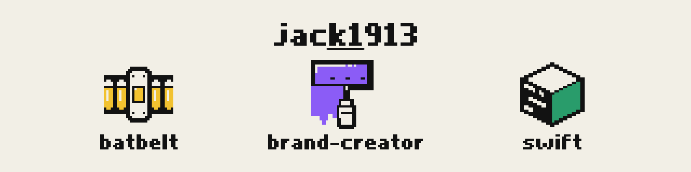

<!-- markdownlint-disable MD041 -->
<div align="center">

<picture><source media="(prefers-color-scheme: dark)" srcset="docs/assets/brand/readme-header-dark.png"></picture>

# jack1913 plugins

**Claude Code plugins that build brand identities, write current Swift, and pressure-test your plans.**

By [Jacek Pytlik](https://github.com/jack1913) · marketplace `jack1913`

[](LICENSE)
[](https://github.com/jack1913/claude-plugins/actions/workflows/batbelt.yml)
[](https://github.com/jack1913/claude-plugins/actions/workflows/brand-creator.yml)
[](https://github.com/jack1913/claude-plugins/actions/workflows/swift.yml)
[](https://github.com/jack1913/claude-plugins/actions/workflows/marketplace.yml)
[](https://github.com/jack1913/claude-plugins/actions/workflows/docs.yml)

[The plugins](#-the-plugins) · [Install](#-install) · [See it work](#-see-it-work) · [Ground rules](#-ground-rules) ·
[Manual](docs/manual/README.md) · [Contribute](#-contributing)

</div>

## 🧰 The plugins

Three plugins, one marketplace. Install only the ones you need.

| | Plugin | Use it to | Docs |
| --- | --- | --- | --- |
| <picture><source media="(prefers-color-scheme: dark)" srcset="docs/assets/brand/brand-creator-dark.svg"></picture> | **brand-creator** | Make a logo, colours and every brand file your product needs, step by step, with you deciding at each step | [card](docs/manual/use/brand-creator.md) · [README](plugins/brand-creator/README.md) |
| <picture><source media="(prefers-color-scheme: dark)" srcset="docs/assets/brand/swift-dark.svg"></picture> | **swift** | Have Claude write current SwiftUI, Swift 6 concurrency and Swift Testing, and review screens against Apple's guidelines | [card](docs/manual/use/swift.md) · [README](plugins/swift/README.md) |
| <picture><source media="(prefers-color-scheme: dark)" srcset="docs/assets/brand/batbelt-dark.svg"></picture> | **batbelt** | Grill a plan before you build it, check a claim against real sources, or set up a repository for Claude | [card](docs/manual/use/batbelt.md) · [README](plugins/batbelt/README.md) |

Not sure which one? [Choose a plugin](docs/manual/getting-started/choose-a-plugin.md).

## 🚀 Install

> [!TIP]
> Add the marketplace once. Every plugin in it then installs as `<plugin>@jack1913`.

```text illustrative
/plugin marketplace add jack1913/claude-plugins
/plugin install batbelt@jack1913
```

Swap `batbelt` for `brand-creator` to get that one. swift goes in once per Swift project. Terminal installs, team
setup, updates and removing a plugin are all in [Install a plugin](docs/manual/getting-started/install-a-plugin.md).

## 👀 See it work

Ask swift in plain words, from [one real run](plugins/swift/README.md#try-it):

> Add a settings screen in Sources/App/SettingsView.swift: show the account's name and email, a notifications toggle,
> and a Sign Out button.

Claude wrote a native settings form, and `swift build` passed. For the other two, see
[making your first brand with brand-creator](plugins/brand-creator/docs/manual/getting-started/make-your-first-brand.md) and
[batbelt's grill-me](plugins/batbelt/docs/manual/use/grill-a-plan.md).

## 🚦 Ground rules

Each plugin draws hard lines around what it does on its own:

- **brand-creator**: [what it never does](plugins/brand-creator/docs/manual/reference/what-it-never-does.md)
- **swift**: [what it never does](plugins/swift/README.md#what-it-never-does), including a review that only reports
- **batbelt**: [prove-it](plugins/batbelt/docs/manual/use/prove-a-claim.md) never answers from memory; [onboard-repo](plugins/batbelt/docs/manual/use/set-up-a-repository.md) shows its plan before it writes

## 🔧 Contributing

Change a plugin, add one, or fix a page: start at [CONTRIBUTING.md](CONTRIBUTING.md). Found a security problem? See
[SECURITY.md](SECURITY.md).

## 📜 License

MIT, see [LICENSE](LICENSE). A plugin's own `LICENSE` and notices cover third-party material in that plugin.
