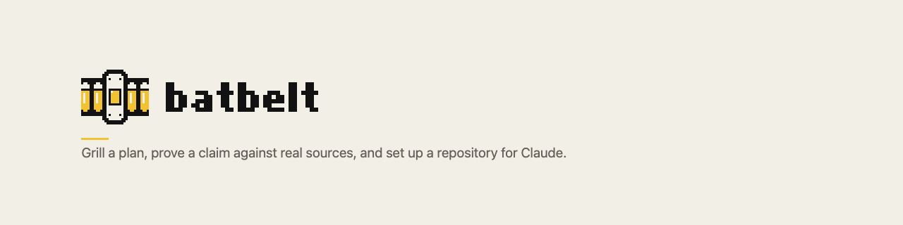

<!-- markdownlint-disable MD041 -->
<picture><source media="(prefers-color-scheme: dark)" srcset="assets/readme-header-dark.png"></picture>

# batbelt

Grill a plan, prove a claim against real sources, set up a repository for Claude, and run background workers.

## Install

```text illustrative
/plugin marketplace add jack1913/claude-plugins
/plugin install batbelt@jack1913
```

Other ways to install (from a shell, for a whole team):
[Install a plugin](../../docs/manual/getting-started/install-a-plugin.md).

## Try it

Say this to Claude, with a plan of your own:

> Grill me on this plan: a nightly job that emails each customer their invoices.

Claude asks you one question at a time. Every question comes with a suggested answer, so you can reply "yes" when it fits.

## What you can do

| Command | Starts | What it's for |
| --- | --- | --- |
| `/batbelt:grill-me` | you or Claude | Stress-test a plan or design before you build it |
| `/batbelt:prove-it` | you or Claude | Check a number, a legal rule or a market claim against real sources |
| `/batbelt:puppet-master` | you or Claude | Run background Claude sessions from one session, one job each |
| `/batbelt:onboard-repo` | you only | Set up a repository so Claude works well in it |

Every command, with its arguments: [Commands](docs/manual/reference/commands.md).

How-to pages:

- [Grill a plan](docs/manual/use/grill-a-plan.md)
- [Prove a claim](docs/manual/use/prove-a-claim.md)
- [Set up a repository](docs/manual/use/set-up-a-repository.md)
- [Run background workers](docs/manual/use/run-background-workers.md)

## What it adds to your sessions

batbelt adds four skills. It adds no hooks, agents or servers.

- **`grill-me`, `prove-it` and `puppet-master`** are skills Claude can start itself. Their short descriptions load into every session, so Claude can tell when your request matches.
- **`onboard-repo`** runs only when you type it. It writes into your repository only after you've seen its plan and said yes. Before that it writes only its own progress record in `.onboard-repo-retired/`, which it keeps out of git.
- **`prove-it`** writes an assumption register, a Markdown file, in the folder you choose. To check claims it searches and fetches web pages, so your search terms and the URLs it reads leave your machine.
- **`puppet-master`** starts, compacts and closes background Claude sessions, which run as you with your settings. It keeps a list of its workers in `~/.claude/puppet-master/workers.json`. It needs Node.js 20 or newer, and a setting you add yourself.
- **`grill-me`** writes nothing. It may read your code to answer its own questions.

## What it never does

- `prove-it` never answers from memory. With no way to search or fetch pages, it stops and tells you.
- `onboard-repo` never changes your repository before you say yes to its plan.
- `onboard-repo` never commits or pushes. You do that.
- `puppet-master` never compacts a worker mid-task, never creates a git worktree, and never changes your settings. Pushes, approvals and anything destructive stay yours.

## Something off?

| You see | Do this |
| --- | --- |
| `/batbelt:onboard-repo` doesn't start when you ask in words | Type the command. It only runs when typed |
| `prove-it` stops with `Research status: BLOCKED` | Add a way to fetch pages, or paste the URLs, then run it again. It picks up where it stopped |
| New skills don't show up after onboarding | Restart Claude Code: `claude --continue` |

More: [Troubleshooting](docs/manual/reference/troubleshooting.md).

## Learn more

- [Manual](docs/manual/README.md)
- [Changelog](CHANGELOG.md)
- [How it works](docs/internals/README.md) (for contributors)

batbelt is released under the [MIT licence](LICENSE).
