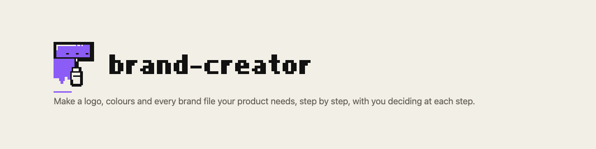

<!-- markdownlint-disable MD041 -->
<picture><source media="(prefers-color-scheme: dark)" srcset="assets/readme-header-dark.png"></picture>

# brand-creator

Make a logo, colours and every brand file your product needs, step by step, with you deciding at each step.

It works for any business or person, not just software: a bakery, a photographer, a band, a law practice, an app. You
describe what you need. Claude shows how brands like yours look and you pick the styles you like, then shows three
different directions on one page and you pick one. Claude builds it and checks it: it renders the logo at real sizes and
measures colour contrast.

Then it takes your brand onto the web: sample pages of your site in your brand, a check of any page against it, and a
brand kit that your website's code carries, so the pages built there stay on brand.

## Install

```text illustrative
/plugin marketplace add jack1913/claude-plugins
/plugin install brand-creator@jack1913
```

Needs Claude Code **2.1.271** or newer. Claude Code only: not claude.ai or Cowork.
Then restart Claude Code, or run `/reload-plugins`, and run `/brand-creator:setup` once. It shows what it will download
(about 200 MB, into the plugin's own data folder) and waits for your yes.

Other ways to install (from a shell, for a whole team):
[Install a plugin](../../docs/manual/getting-started/install-a-plugin.md).

## Try it

Say this to Claude, with your own business:

> A logo and a look for my bakery

You get up to three quick questions, each with a suggested answer. Then a style board shows how brands like yours look,
with real examples, and you pick the styles you like. Then one page shows three clearly different
directions, plus "None of these". Answer by name, or like `1a 2b`. `ok` accepts every suggestion. Your project gets its
own folder, like `./my-bakery/`.

The whole walk-through: [Make your first brand](docs/manual/getting-started/make-your-first-brand.md).

## What you can do

| Say or type | Starts | What you get |
| --- | --- | --- |
| "a logo and a look for my bakery" | you or Claude | The whole process, start to finish |
| "favicons from my logo.svg" | you or Claude | Icons and social images from a logo you already have, no project needed |
| "name ideas for my bakery", "is the name X taken" | you or Claude | Name ideas, or a check on a name you have |
| "generate the brand book" | you or Claude | A brand book page built from your project |
| "sample pages for my website" | you or Claude | Real sites you like first, then your first screen and pages in your brand, each choice marked as a rule or an example |
| "write the brand kit" | you or Claude | Your brand in one folder your website's code can carry, with a step-by-step recipe for a page |
| `/brand-creator:round`, `status`, `check`, `review` | you only | The next round, where you are, every check, a review as one list |
| `/brand-creator:check --page <page>` | you only | Where a page you or someone else built breaks your brand: colours, fonts, logo, claims |
| `/brand-creator:brand-adopt` | you only | A read-only look at where the brand belongs in your repositories, then, when you say go, the brand and its kit applied on a branch you name |
| `/brand-creator:launch` | you only | Your launch checklist, one step at a time |

Every command, with its arguments: [Commands](docs/manual/reference/commands.md). How far to go (Quick, Standard or
Full): [Choose a tier](docs/manual/getting-started/choose-a-tier.md).

## What it adds to your sessions

- **Skills.** Four skills Claude can start itself when your request matches: `brand-creator`, `brand-naming`,
  `brand-assets` and `brand-book`. Their short descriptions load into every session. The other commands run only when you
  type them.
- **A safety hook.** Before Claude writes a file or runs a shell command, a check runs. Outside a brand project it does
  nothing. Inside one it keeps finished rounds read-only and stops the project folder being deleted or moved. It needs
  `python3`.
- **Agents, only with your approval.** Seven agents and four workflows can run in parallel for Standard and Full projects.
  Before any run you see how many, which models and a rough cost, and you say yes.
- **Network, only after your OK.** Setup downloads tools after you say yes. A name check sends names to registries after
  you agree. Boards go to claude.ai as a private page only if you allow it.
- **Files it writes.** Your brand project folder, and the plugin's data folder for the tools. Your product repositories
  change only after you say go, on a branch you name.
- **A brand kit, if you ask for one.** A skill for your brand (`.claude/skills/<brand>-brand/`) in your brand project and,
  once you apply it, in your product repository, so Claude working there builds in your brand.
- **Connectors.** None needed, and no MCP server ships: [CONNECTORS.md](CONNECTORS.md).

## What it never does

- Buy a domain, file a trademark, register a handle or contact anyone. It hands you each step instead.
- Build or publish your real website. It makes sample pages and a kit; your site is built in its own repository.
- Commit, push or delete on its own. Replaced files move to a dated folder.
- Call a name "available", or a print file "print-ready".

The full list: [What it never does](docs/manual/reference/what-it-never-does.md).

## Something off?

| You see | Do this |
| --- | --- |
| A tool stops with "cannot run" | Run `/brand-creator:setup` |
| `brand-creator: command not found` | Check the plugin is enabled (`/plugin`) and restart Claude Code |
| A permission prompt on every call | Add one rule: [Permissions](docs/manual/reference/permissions.md) |
| Shots "not verified" | Chromium is missing: run `/brand-creator:setup` |

More: [Troubleshooting](docs/manual/reference/troubleshooting.md).

## Learn more

- [Manual](docs/manual/README.md)
- [Take your brand to the web](docs/manual/getting-started/take-your-brand-to-the-web.md): your site, a page check and your
  brand kit, step by step
- [Platform support](docs/manual/reference/platform-support.md): macOS full, Linux tested in a container, Windows untested
- [Costs](docs/manual/reference/costs.md)
- [Changelog](CHANGELOG.md)
- [How it works](docs/internals/README.md) (for contributors)

brand-creator is released under the [MIT licence](LICENSE). Third-party notices: [THIRD_PARTY_NOTICES.md](THIRD_PARTY_NOTICES.md).
