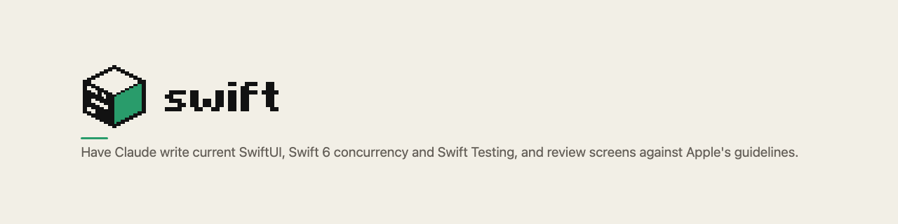

<!-- markdownlint-disable MD041 -->
<picture><source media="(prefers-color-scheme: dark)" srcset="assets/readme-header-dark.png"></picture>

# swift

Have Claude write current SwiftUI, Swift 6 concurrency and Swift Testing, and review screens against Apple's guidelines.

## Install

Install it once per Swift project. Run this inside the project:

```text illustrative
claude plugin marketplace add jack1913/claude-plugins --scope project
claude plugin install swift@jack1913 --scope project
```

On Claude Code older than 2.1.281, add `--scope project` to `claude plugin update` as well.
`--scope project` writes the project's committed `.claude/settings.json`, so everyone who clones the project gets the plugin. Use `--scope local` to keep it to yourself.
More ways to install, and updating: [Enable the plugin in a Swift repo](docs/manual/getting-started/enable-in-a-swift-repo.md) and [Install a plugin](../../docs/manual/getting-started/install-a-plugin.md).

## Try it

Ask in plain words. The right skills load on their own:

> Add a settings screen in Sources/App/SettingsView.swift: show the account's name and email, a notifications toggle, and a Sign Out button.

One real run wrote a native settings form, and `swift build` passed:

```text capture=use-swiftui-plain-code
        Form {
            Section("Account") {
                LabeledContent("Name", value: account.name)
                LabeledContent("Email", value: account.email)
            }

            Section {
                Toggle("Notifications", isOn: $notificationsEnabled)
            }

            Section {
                Button("Sign Out", role: .destructive, action: onSignOut)
            }
        }
        .formStyle(.grouped)
        .navigationTitle("Settings")
```

The whole run: [Build a SwiftUI screen](docs/manual/use/build-a-swiftui-screen.md).

## What you can do

| Command | Starts | What it's for |
| --- | --- | --- |
| `/swift:swiftui` | you or Claude | Write and refactor SwiftUI with current APIs |
| `/swift:design` | you or Claude | Build and restyle screens the Apple-native way |
| `/swift:concurrency` | you or Claude | Fix Swift 6 concurrency errors and migrate to Swift 6 |
| `/swift:testing` | you or Claude | Write Swift Testing tests and migrate XCTest |
| `/swift:review` | you only | Review a screen against Apple's guidelines, from code or a screenshot |

Every command, with its arguments: [Commands](docs/manual/reference/commands.md). What each skill covers: [What the plugin covers](docs/manual/reference/capabilities.md).

How-to pages:

- [Build a SwiftUI screen](docs/manual/use/build-a-swiftui-screen.md)
- [Fix a concurrency error](docs/manual/use/fix-a-concurrency-error.md)
- [Write tests](docs/manual/use/write-tests.md)
- [Review a screen](docs/manual/use/review-a-screen.md)

## What it adds to your sessions

swift adds five skills. It adds no hooks, agents or servers.

- **`swiftui`, `design`, `concurrency` and `testing`** are skills Claude can start itself. Their short descriptions load into every session, so Claude can tell when your request matches.
- **`review`** runs only when you type `/swift:review`. It reads the files and screenshots you name, and nothing else.
- **Your own rules come first.** The skills follow your design tokens, and your `AGENTS.md` and `CLAUDE.md`, over their own defaults.

## What it never does

- `/swift:review` never edits a file. It reports, and the fix is described in the finding.
- It never adds Liquid Glass unless you ask for it.
- It never loads in a project that did not enable it, when you install with `--scope project`.

## Something off?

| You see | Do this |
| --- | --- |
| `/swift:review` doesn't start when you ask in words | Type the command. It only runs when typed |
| Still the old version after an update | Run `claude plugin marketplace update jack1913` and `claude plugin update swift@jack1913`, then start a new session |
| An older install (`swift@swift-plugin` or `swift@jack1913-plugins`) | Move it: [Upgrading from an older install](docs/manual/getting-started/enable-in-a-swift-repo.md#upgrading-from-an-older-install) |

## Learn more

- [Manual](docs/manual/README.md)
- [Changelog](CHANGELOG.md)
- [How it works](docs/internals/README.md) (for contributors)

swift is released under the MIT licence: [LICENSE.md](LICENSE.md). The `swiftui`, `concurrency` and `testing` skills are forks of upstream skills that are also MIT; their notices are in [NOTICE.md](NOTICE.md).
